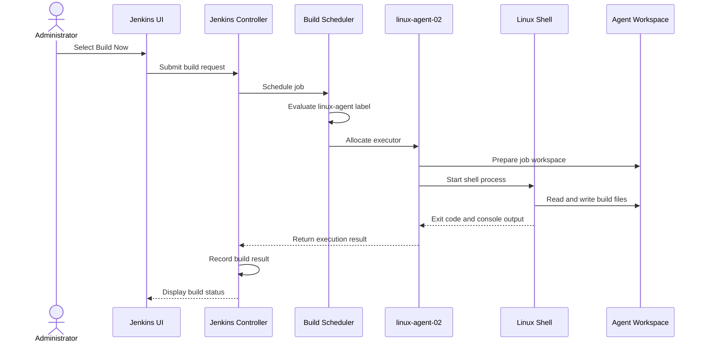
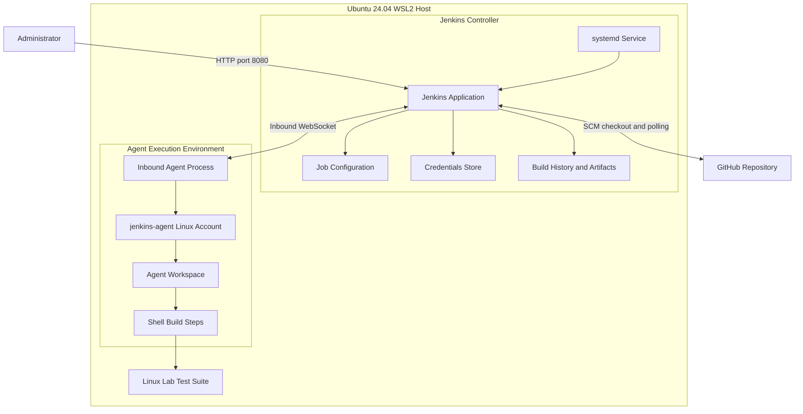

# Jenkins Architecture and Execution Internals

## 1. Purpose

This guide explains the Jenkins controller, execution agents, job scheduling, workspaces, shell execution and build results.

The lab uses Jenkins on Ubuntu 24.04 under WSL2. The controller and inbound agent run on the same WSL2 host but use separate Linux accounts and execution environments.

## 2. Implemented Environment

| Component | Value |
|---|---|
| Operating system | Ubuntu 24.04 on WSL2 |
| Init system | systemd |
| Java | OpenJDK 21 |
| Jenkins home | /var/lib/jenkins |
| Jenkins port | 8080 |
| Controller account | jenkins |
| Agent name | linux-agent-02 |
| Agent account | jenkins-agent |
| Agent label | linux-agent |
| Agent connection | Inbound WebSocket |

## 3. Controller Responsibilities

The Jenkins controller is the central service. It:

- Serves the Jenkins web interface on port 8080.
- Stores job configuration and build history.
- Loads installed plugins.
- Schedules builds and selects eligible execution nodes.
- Coordinates source checkout and build execution.
- Collects console output, build status and archived artifacts.

The controller runs as the Linux account `jenkins`.

Important paths:

| Path | Purpose |
|---|---|
| `/var/lib/jenkins` | Persistent Jenkins home |
| `/var/log/jenkins` | Configured log directory |
| `/var/cache/jenkins` | Jenkins cache |
| `/usr/lib/systemd/system/jenkins.service` | Service unit |
| `http://localhost:8080` | Local Jenkins interface |

## 4. Controller and Agent

The controller manages Jenkins. An agent provides an execution environment for builds assigned to it.

The lab agent configuration:

- Name: `linux-agent-02`
- Remote root: `/home/jenkins-agent`
- Executors: 1
- Label: `linux-agent`
- Usage: only matching label expressions
- Launch method: inbound WebSocket
- Linux account: `jenkins-agent`

The agent runs on the same WSL2 host as the controller. It has a different Linux user identity and workspace, but shares the host kernel and machine. It is not a separate physical server or VM.

## 5. Build Execution Lifecycle

1. An administrator or trigger requests a build.
2. Jenkins schedules the job.
3. Jenkins evaluates the job's node restrictions and labels.
4. An eligible executor is allocated.
5. The agent or controller starts the configured build steps.
6. Shell commands execute in the job workspace.
7. The process returns an exit code and console output.
8. Jenkins records the result and configured artifacts.

A successful shell command normally returns exit code zero. A non-zero exit code marks the shell build step as failed. Subsequent ordinary build steps are normally skipped after failure.

## 6. Shell Steps and Workspace

Multiple shell build steps in a Freestyle job use the job workspace. A file created by one step can be read by a later step, provided the workspace has not been cleaned or replaced.

Example:

```bash
#!/bin/bash
set -e
mkdir -p output
echo "Build $BUILD_NUMBER" > output/build-info.txt
```

A later shell build step can read the generated file:

```bash
cat output/build-info.txt
```

The workspace is shared between the shell build steps of the same job execution, provided the workspace has not been cleaned or replaced.

`set -e` causes the shell to exit when a command fails in ordinary cases. Jenkins uses the resulting process exit status to determine whether the shell step succeeded.

## 7. Important Jenkins Environment Variables

Jenkins provides environment variables to build steps.

| Variable | Meaning |
|---|---|
| `BUILD_NUMBER` | Current build number |
| `JOB_NAME` | Jenkins job name |
| `WORKSPACE` | Build workspace path |
| `BUILD_TAG` | Build identifier, not build result |
| `JENKINS_HOME` | Jenkins controller home directory |

Example:

```bash
echo "Job: $JOB_NAME"
echo "Build: $BUILD_NUMBER"
echo "Workspace: $WORKSPACE"
```

Do not use `BUILD_TAG` as a success or failure status. It identifies a build; it does not represent its result.

## 8. Build Lifecycle and Failure Handling

A Jenkins build generally passes through these stages:

1. Build request received.
2. Job placed in the queue.
3. Eligible executor selected.
4. Build steps executed.
5. Exit status and console output returned.
6. Build result recorded.
7. Applicable post-build actions executed.
8. Build completed.

The lab tested successful builds and an intentional failure using `exit 1`.

When a required shell step returns a non-zero exit status, Jenkins marks the step as failed and normally skips subsequent ordinary build steps.

A build can have a post-build action such as artifact archiving configured separately. Such an action may still run after a failed build, depending on its configuration.

## 9. Workspace, Build Retention and Artifacts

These are three different concepts.

**Workspace**

The working directory used by a job during execution. It contains checked-out source code and temporary or generated files.

**Build retention**

Controls how long Jenkins retains build records and how many historical builds are kept.

In this lab, the first Freestyle job was configured to retain builds for 14 days, with a maximum of 10 builds.

**Artifact archiving**

Stores selected build outputs with the Jenkins build record.

The lab generated:

`output/build-report.txt`

The configured archive pattern was:

`output/*.txt`

The presence of an archived artifact does not independently prove that a build succeeded.

## 10. Controller and Agent Execution Sequence

The following sequence describes how the lab's agent-restricted build executes:



The controller coordinates execution. The shell process runs on the selected node. In this lab, the agent's separate Linux account is used for the shell execution.

## 11. Overall Jenkins Lab Architecture



Both controller and agent run on the same WSL2 host. They are separate execution identities, not separate machines.

## 12. What Was Demonstrated

The following practical exercises were completed:

- Jenkins controller and built-in node inspection.
- First Freestyle job creation and execution.
- Successful and intentionally failed builds.
- Multiple shell build steps.
- File communication through the job workspace.
- Build retention configuration.
- Workspace cleanup.
- Build artifact generation and archiving.
- Parameterized build validation.
- GitHub checkout and automated test execution.
- Inbound agent execution under a separate Linux account.

## 13. Learning and Interview Questions

You should be able to explain:

1. What is the difference between a Jenkins controller and an agent?
2. What is an executor?
3. How does Jenkins determine whether a shell build step succeeded?
4. Why can two shell steps access the same workspace file?
5. What is the difference between a workspace and an archived artifact?
6. What is the difference between build retention and workspace cleanup?
7. What does `BUILD_NUMBER` represent?
8. Why is `BUILD_TAG` not a build result?
9. Where does a shell process execute when a job is restricted to an agent?
10. Why is the agent in this lab not a separate physical machine?

## 14. Troubleshooting

**Build remains queued**

- Check whether an eligible executor is available.
- Check node availability and label restrictions.
- Confirm the agent is online if the job requires it.

**Shell step fails**

- Inspect the console output.
- Check the command's exit status.
- Verify file permissions and required tools.
- Check whether an expected file exists in the workspace.

**Workspace file is missing**

- Check the configured workspace.
- Check whether workspace cleanup ran.
- Check whether the preceding build step successfully generated the file.

**Artifact is missing**

- Confirm the output file was generated.
- Verify the archive pattern.
- Review the post-build action and console output.

## 15. Scope and Limitations

This project demonstrates Jenkins fundamentals and administration in a local WSL2 learning environment.

It does not demonstrate a separate physical agent, a production high-availability controller, a fully tested restore procedure, or a production deployment pipeline.

Declarative Pipeline and Jenkinsfile implementation can be covered in a separate Jenkins Pipeline project.
