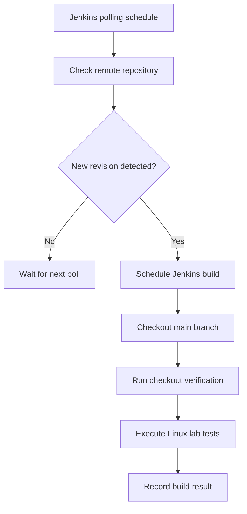

# Jenkins Jobs, GitHub Integration and Build Management

## 1. Purpose

This document explains the Jenkins jobs implemented in this lab, how
they execute, how GitHub source code is checked out, and how repository
changes trigger automated validation.

The exercises demonstrate Freestyle jobs, shell execution, build
parameters, workspace management, artifact archiving, SCM polling,
and automated test execution.

## 2. Jobs Implemented

| Job | Purpose |
|---|---|
| `01-freestyle-first-build` | Freestyle job fundamentals |
| `02-github-source-checkout` | GitHub checkout and automated tests |
| `03-credentials-security-demo` | Credentials binding demonstration |
| `04-linux-agent-execution-demo` | Agent-side execution verification |

## 3. Freestyle Job: First Build

The job `01-freestyle-first-build` was created to understand
Jenkins build execution and Linux shell integration.

Exercises included:

- Successful build execution.
- Intentional failure using `exit 1`.
- Restoring the script and obtaining a successful build.
- Multiple shell build steps.
- Jenkins environment variables.
- Sharing files through the job workspace.
- Build retention and workspace cleanup.
- Artifact generation and archiving.
- Parameterized builds.

### Successful and Failed Builds

Example intentional failure:

```bash
#!/bin/bash
echo "This build step will fail"
exit 1
```

A non-zero exit code tells Jenkins that the shell build step failed.
Subsequent ordinary build steps are normally skipped.

This demonstrates why required operations should stop the build
when they fail instead of allowing later steps to continue.

### Multiple Shell Steps

The job used multiple Execute shell build steps.

One step generated a file:

```bash
mkdir -p output
echo "Generated by build $BUILD_NUMBER" > output/build-info.txt
```

A later step read the file:

```bash
cat output/build-info.txt
```

Both steps used the same job workspace during that build execution.

### Build Retention

The job was configured to discard old builds:

- Maximum age: 14 days.
- Maximum number of builds: 10.

Build retention controls stored build history. It is different from workspace cleanup.

### Workspace Cleanup

The Workspace Cleanup plugin was configured to delete the workspace before a build.

This removes old working files before the new execution begins.

### Artifact Archiving

The job generated `output/build-report.txt`.

The configured archive pattern was `output/*.txt`.

Jenkins stores matching files as archived artifacts associated with the build record.

An archived artifact does not independently prove that a build succeeded.

## 4. Parameterized Builds

The Freestyle job used a parameter named `TARGET_ENV`.

Permitted values:

- development
- testing
- staging

The exercise tested valid values and an invalid production value. The invalid choice was rejected by the configured parameter options.

This demonstrates how build parameters control job inputs. Scripts should still validate parameter values before using them.

## 5. GitHub Source Checkout

The job `02-github-source-checkout` checks out the public repository:

`https://github.com/abhinav1408krishna/devops-journey.git`

Configured branch specifier:

`*/main`

No GitHub credentials were required for this public repository.

The Git plugin performs the checkout and prepares the workspace. Subsequent shell steps execute commands against the checked-out repository.

### Checkout Verification Script

The job used this verification script:

```bash
#!/bin/bash
set -e

echo "GITHUB CHECKOUT VERIFICATION"
echo "Job: $JOB_NAME"
echo "Build: $BUILD_NUMBER"

pwd
git rev-parse --show-toplevel
git branch --show-current
git log -1 --oneline
ls -la
git status --short
```

## 6. Automated Linux Lab Test Execution

After checkout, the job executes the Linux Server Administration Lab test suite.

The test execution script:

```bash
#!/bin/bash
set -euo pipefail

PROJECT_DIR="$WORKSPACE/Projects/Linux-Server-Administration-Lab"

echo "Execution identity:"
id

echo "Running Linux lab tests..."
bash "$PROJECT_DIR/tests/run-all-tests.sh"
```

The test suite contains 11 test suites.

Two portability fixes were required before Jenkins validation succeeded:

1. Create `local-output/` before writing the runner report.
2. Explicitly set the demonstration file mode to `640` before checking permissions.

The fixes were committed as:

`a69c22f Fix Linux lab test portability`

The Jenkins test execution subsequently passed all 11 suites.

## 7. SCM Polling and Automatic Build Triggering

The GitHub checkout job was configured with SCM polling.

Observed polling schedule:

`H/5 * * * *`

Jenkins periodically checks the configured repository for changes.

A README change was committed and pushed to GitHub:

`8e01fe0 Document Jenkins CI integration`

Jenkins detected the source change and automatically started Build #4.

The console output included:

`Started by an SCM change`

Build #4 completed successfully, including the Linux lab test suite.

### SCM Polling Flow



SCM polling was verified. A GitHub webhook was not configured in this exercise.


## 8. Scheduled Builds vs SCM Polling

Jenkins supports different mechanisms for starting builds.

### Scheduled Builds

Scheduled builds use a cron-style expression to start a job at configured intervals, regardless of whether the source repository has changed.

Example:

`H/5 * * * *`

This schedules execution approximately every five minutes.

### SCM Polling

SCM polling checks the configured source repository for new changes.

When Jenkins detects a new revision, it schedules a build.

The GitHub checkout job used SCM polling to detect repository changes.

### Key Difference

| Feature | Scheduled Build | SCM Polling |
|---|---|---|
| Trigger condition | Configured time interval | Detected source change |
| Requires Git changes | No | Yes |
| Main purpose | Regular execution | Change-based validation |
| Example use | Periodic maintenance | Source code validation |

SCM polling was verified in this lab. A GitHub webhook was not configured.

## 9. Build Execution Results

The following results were observed during the exercises:

| Build or Exercise | Result |
|---|---|
| Initial Freestyle build | SUCCESS |
| Intentional shell failure | FAILURE |
| Restored Freestyle build | SUCCESS |
| Parameter validation | Invalid production value rejected |
| GitHub source checkout | SUCCESS |
| Initial automated test execution | FAILURE: 9 of 11 suites passed |
| Corrected automated test execution | SUCCESS: 11 of 11 suites passed |
| SCM polling after README update | Automatically triggered Build #4 |
| Build #4 automated test execution | SUCCESS: 11 of 11 suites passed |

The initial test failure helped identify portability issues in the Linux lab. After correcting the test setup and pushing the changes, Jenkins successfully executed all 11 test suites.

## 10. Troubleshooting

### GitHub Checkout Fails

Possible causes:

- Incorrect repository URL.
- Incorrect branch specifier.
- Git executable missing or incorrectly configured.
- Network connectivity problems.
- Authentication required for a private repository.

Useful checks:

- Verify the repository URL.
- Confirm that the configured branch is `*/main`.
- Check the Git tool configuration in Jenkins.
- Review the Git checkout messages in the build console.

### Automated Tests Fail in Jenkins

Possible causes:

- Test scripts are missing from the checked-out repository.
- File permissions are incorrect.
- The test runner assumes a directory already exists.
- The Jenkins execution environment differs from the interactive user environment.

Recommended approach:

1. Inspect the first failing test in the console output.
2. Check the test runner and referenced script paths.
3. Verify required directories and file permissions.
4. Reproduce the failure locally where possible.
5. Correct the source code and validate the full test suite again.

### SCM Polling Does Not Trigger a Build

Check:

- SCM polling is enabled for the correct job.
- The repository URL and branch are correct.
- The polling schedule is configured correctly.
- A new commit exists on the tracked branch.
- Jenkins can access the remote repository.

Review the job's polling log and build history to determine whether a revision was detected.

### Archived Artifacts Are Missing

Check:

- The artifact file was generated in the workspace.
- The archive pattern matches the generated file.
- The archive step is configured under Post-build Actions.
- The build console output contains an artifact archiving message.

## 11. Key Learning Outcomes

After completing this lab, the following Jenkins concepts were demonstrated:

- Creating and configuring Freestyle jobs.
- Executing Linux shell commands through Jenkins.
- Understanding build success and failure.
- Using Jenkins environment variables.
- Sharing files through a job workspace.
- Managing build retention and workspace cleanup.
- Generating and archiving build artifacts.
- Using parameters to control build inputs.
- Checking out source code from GitHub.
- Executing automated Linux test suites.
- Configuring SCM polling.
- Understanding automatic build triggering after repository changes.

The exercises demonstrate basic Jenkins administration and source-code validation. They do not implement a Jenkinsfile-based Pipeline or a GitHub webhook.
